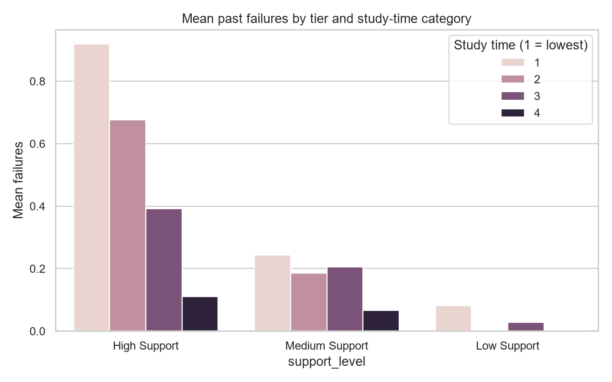
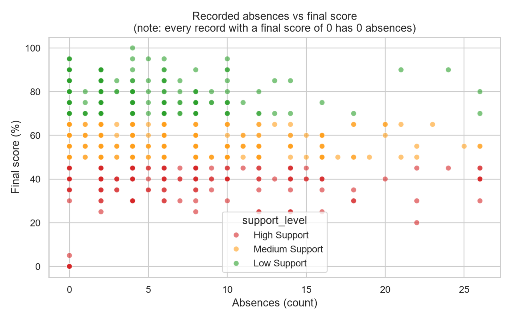
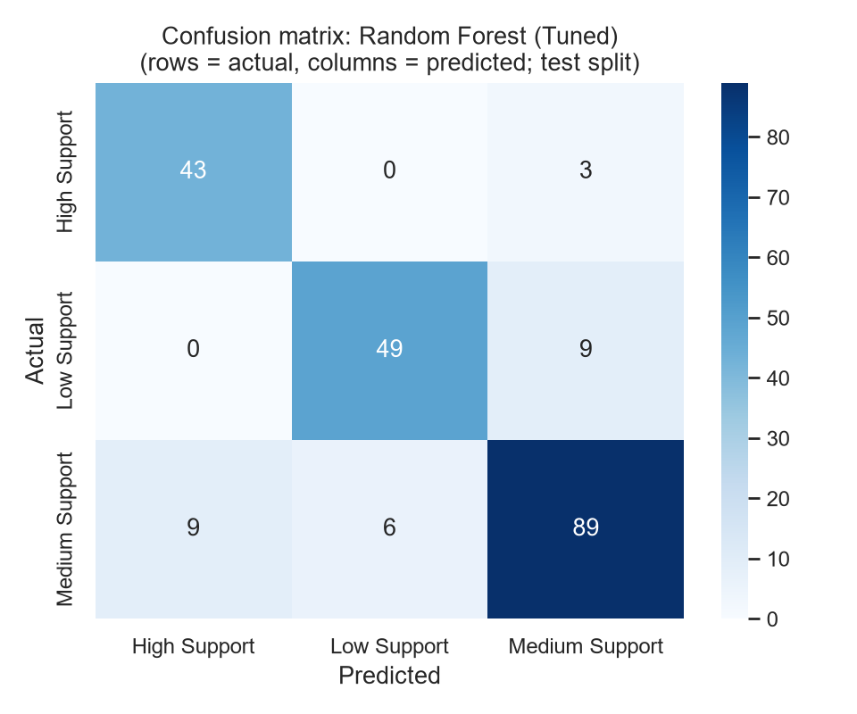
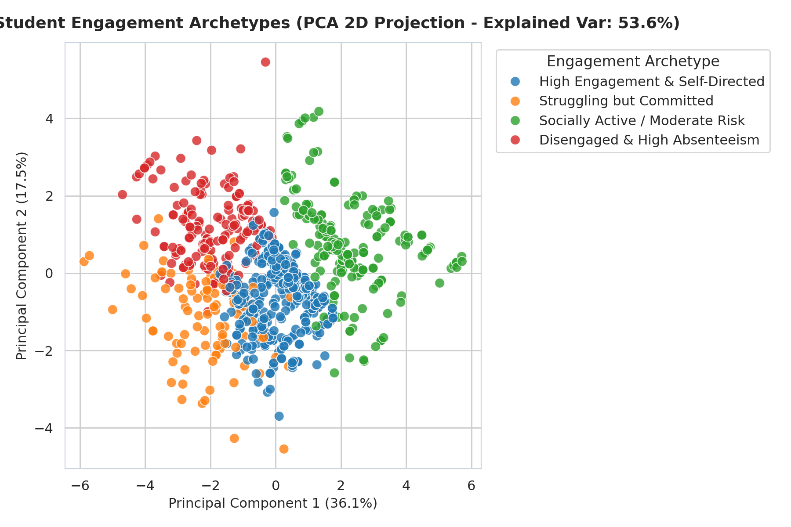

# 🎓 TREKVERSE — Intelligent Academic Performance Monitoring & Recommendation System

[](https://www.python.org/)
[](https://streamlit.io/)
[](https://scikit-learn.org/)
[](https://shap.readthedocs.io/)
[](https://www.sqlite.org/)
[](https://www.reportlab.com/)
[](https://pytest.org/)
[](LICENSE)

---

### 🌐 Live Application & Repository Links

> 🔗 **Active Web Application (Local Host)**: [http://localhost:8501](http://localhost:8501)  
> 🚀 **Deployable on Streamlit Cloud**: [Streamlit Community Cloud Deployment](https://share.streamlit.io/)  
> 📦 **GitHub Official Repository**: [https://github.com/Tharun-720/Intelligent-Academic-Performance-Monitoring](https://github.com/Tharun-720/Intelligent-Academic-Performance-Monitoring)  
> 👤 **Lead Author**: **Salapala Tharun Kumar Reddy** · **ID**: `232G1A3249` · **Institution**: Trekverse AI Academy  

---

## 📌 Executive Summary

**TREKVERSE Intelligent Academic Performance Monitoring & Recommendation System** evolves traditional, static student grade prediction into an institutional-grade, multi-role decision-support platform. Rather than merely forecasting an isolated final exam score, the platform unifies:

* 📊 **Longitudinal Academic Progress Monitoring**: Tracks subject-level internal evaluations, class attendance trends, and behavioral consistency across semesters.
* 🔮 **Predictive Performance Forecasting**: Grouped student-aware regression predicting final performance on both a 0–100 scale and 0–20 academic scale with 95% uncertainty intervals.
* 🚨 **Calibrated Early-Warning System**: Transparent risk classification (🟢 **Low Risk**, 🟡 **Moderate Risk**, 🔴 **High Risk**) linked to concrete intervention workflows.
* 🧠 **Explainable AI (SHAP)**: Local feature attributions highlighting top positive momentum drivers and vulnerability factors per prediction.
* 🎛️ **Interactive What-If Scenario Simulator**: Simulates improvements in study habits, attendance recovery, and mid-term targets with live delta feedback.
* 📅 **AI-Personalized Study Planner**: Dynamic weekly schedules tailored to student-specific weak subjects, available daily hours, and upcoming exam deadlines.
* 🏛️ **Role-Based Portals (RBAC)**: Dedicated, authenticated workflows for **Administrators**, **Faculty Mentors**, and **Students**.
* 📥 **Institutional Data Ingestion & Validator**: Multi-format import for **CSV** and **Excel (`.xlsx`)** with automated column mapping wizards and row-level range checks.
* 📄 **Certified PDF Report Generation**: One-click compilation of institutional academic progress summaries using ReportLab.
* 🗄️ **Relational Database Persistence**: Backed by a normalized SQLite schema logging users, cohorts, attendance, marks, predictions, and faculty interventions.

---

## 🌟 Visual Showcase & Analytics Gallery

Here are the key visual analytics and model diagnostic outputs generated by the platform:

| 📈 Final Grade Distribution & Support Tiers | 🗺️ Curricular Correlation Matrix |
| :---: | :---: |
|  |  |

| 🎯 Attendance Regularity vs Academic Achievement | 📉 Longitudinal Evaluation Trajectory (G1 → G2 → Final) |
| :---: | :---: |
|  |  |

| ⏱️ Study Hours & Past Backlogs by Support Tier | 📉 Classroom Absences vs Final Exam Marks |
| :---: | :---: |
|  |  |

| 🏆 Candidate Regressor Performance Benchmark | 🔬 Residual Error Diagnostics & Quantile Plot |
| :---: | :---: |
|  |  |

| 🎯 Confusion Matrix & Classification Reliability | 🕸️ K-Means Student Behavioral Archetypes |
| :---: | :---: |
|  |  |

---

## 🚀 Core Platform Capabilities

### 1. 🚨 Academic Monitoring & Calibrated Early-Warning System

Multi-dimensional academic indicators (attendance %, internal assessments G1/G2, previous backlogs, study hours) are evaluated against transparent, agreed risk bands:

| Risk Tier | Meaning | Prescribed Institutional Protocol |
| :--- | :--- | :--- |
| 🟢 **Low Risk** | On track for all academic milestones; satisfactory performance. | Continue normal monitoring, encourage honors/advanced electives. |
| 🟡 **Moderate Risk** | One or more indicators indicate emerging academic vulnerability. | Faculty check-in, review weak course modules, agree on 2-week study plan. |
| 🔴 **High Risk** | Multiple critical flags (low attendance, failing internals, backlogs). | Immediate faculty mentoring, attendance recovery plan, and remedial tutoring. |

---

### 2. 🎛️ What-If Academic Scenario Simulator

Allows students and faculty mentors to explore "what-if" habit changes without altering actual student records:
* **Interactive Variables**: Dedicated weekly study hours, attendance recovery, and mid-term grade targets.
* **Side-by-Side Comparison**: Displays baseline model output vs simulated scenario with calculated score deltas (e.g. `+12.4%` / `+2.5 grade points`).
* **Governance**: Explicitly labeled as statistical estimates, never guarantees. Database records remain immutable.

---

### 3. 👥 Multi-Role Experiences & Portals (RBAC)

```
TREKVERSE Application
├── 👑 Administrator Control Center (app/pages/admin.py)
│   ├── Academic Metadata & Role Management (Users, Faculty, Students)
│   ├── Institutional Dataset Import & Validator (CSV & Excel .xlsx)
│   ├── Automated Column Mapping Wizard & Row-Level Error Reports
│   ├── Machine Learning Model Registry & Health Monitoring
│   ├── System Audit Logs & Operational Security Trails
│   └── Configurable Risk Thresholds & Institutional Governance
│
├── 👨‍🏫 Faculty Intervention Dashboard (app/pages/faculty.py)
│   ├── Cohort Surveillance (Class average, attendance average, risk distribution)
│   ├── Priority Early-Warning Roster (High & Moderate risk queues)
│   ├── Student Diagnostic Deep-Dive (Subject marks, attendance, failure counts)
│   ├── Faculty Intervention Workflow (Record mentoring notes, remedial actions)
│   └── Longitudinal Intervention History & Outcome Tracking
│
└── 🎓 Student Academic Portal (app/pages/student.py)
    ├── Profile & Degree Progress (Roll number, current semester, standing)
    ├── Enrolled Courses, Marks Breakdown, and Attendance Monitor
    ├── AI Early-Warning Diagnostics & Factor Explanations
    ├── Interactive AI-Personalized Weekly Study Planner (Task checklists)
    └── Downloadable Certified Academic PDF Report
```

---

### 4. 🧠 Explainable AI (SHAP)

* Implemented with **TreeExplainer** in [`src/explainability/shap_explainer.py`](src/explainability/shap_explainer.py).
* Breaks down individual predictions into interpretable additive contributions:
  * 🟢 **Positive Momentum Drivers**: Strong internal exam scores, consistent attendance, high study commitment.
  * 🔴 **Vulnerability Factors**: High absenteeism, previous course backlogs, inadequate self-study time.
* Strictly framed as decision support for educators rather than proof of causation.

---

### 5. 📅 AI-Personalized Weekly Study Planner

* Automatically calculates a weekly revision roadmap based on diagnosed subject weaknesses, daily study time availability, and target exams.
* **Interactive Checklist**: Students can mark individual study blocks complete as they progress throughout the week.
* **Actionable Tips**: Targeted recommendations for past papers, formula sheets, and peer problem-solving.

---

### 6. 📄 Certified Institutional PDF Report Generator

Built using **ReportLab** in [`reports/report_generator.py`](reports/report_generator.py), compiling complete institutional summaries:
1. **Institutional Header**: Official TREKVERSE branding, document timestamp, and security verification.
2. **Student Demographic Summary**: Roll number, department, semester, cumulative CGPA, and attendance %.
3. **Curricular Course Performance Table**: Credits, attendance %, internal scores, and evaluation standing.
4. **AI Performance Forecast & Risk Classification**: Predicted score, 95% uncertainty interval, and risk band.
5. **Top SHAP Factor Attributions**: Highlights key positive and negative momentum drivers.
6. **Weekly Study Action Roadmap**: Day-by-day customized study plan.
7. **Authorized Faculty Remarks**: Formal comments and mentor follow-up milestones.
8. **Institutional Governance Disclaimer**: Reinforces decision-support ethics and human oversight.

---

## 🔬 Machine Learning Pipeline & Empirical Benchmarks

The machine learning pipeline is evaluated using **Grouped 5-Fold Cross-Validation** (grouped by student fingerprint to strictly prevent data leakage) and validated against a held-out test split of **208 student records**:

### 🏆 Model Selection & Metrics

| Task | Selected Model | Test Metric | CV Benchmark | Baseline (Linear / Dummy) |
| :--- | :--- | :--- | :--- | :--- |
| **Grade Regression (0–100%)** | **Gradient Boosting (Tuned)** | **MAE: 4.54** · **R²: 0.795** | CV MAE: **4.27** | Linear Regression: MAE 4.88 |
| **Risk Classification** | **Random Forest (Tuned)** | **Accuracy: 87.0%** · **Macro-F1: 0.871** | CV F1: **0.855** | Dummy: 35.1% |
| **Behavioral Segmentation** | **K-Means ($k=4$)** | **Silhouette: 0.28** | 4 Interpretable Archetypes | Baseline Centroids |

---

## 🗄️ Relational Database Architecture

Implemented with **SQLite** and SQLAlchemy in [`database/schema.sql`](database/schema.sql):

* `users`: Identity authentication, SHA-256 password hashing, and system roles (`admin`, `faculty`, `student`).
* `departments`: Academic division codes, department names, and department heads.
* `faculty`: Faculty IDs, employee codes, designations, and department associations.
* `students`: Roll numbers, names, semesters, CGPA, average attendance, and risk standing.
* `subjects`: Course codes, subject titles, credit allocations, and semester mappings.
* `attendance`: Class session tracking, attended sessions, and attendance percentages.
* `marks`: Exam types (`Internal-1`, `Internal-2`, `Quiz`, `Final`), scores, and percentages.
* `predictions`: Persisted ML forecast scores, risk classifications, uncertainty bounds, and model versions.
* `interventions`: Faculty mentoring records, action notes, follow-up dates, and review statuses.
* `audit_logs`: Governance trail tracking security events, dataset uploads, and policy adjustments.

---

## 📂 Project Structure

```
Intelligent-Academic-Monitoring/
├── app/
│   ├── app.py                     # Main Portal with Session State & Role Routing
│   ├── main.py                    # Consolidated Multi-Tab Application
│   └── pages/
│       ├── admin.py               # 🏛️ Administrator Dashboard & Settings
│       ├── faculty.py             # 👨‍🏫 Faculty Dashboard & Intervention Queue
│       ├── student.py             # 🎓 Student Dashboard, Planner & PDF Report
│       ├── analytics.py           # 📊 Academic Visual Analytics
│       ├── prediction.py          # 🔮 ML Performance Forecast & What-If Simulator
│       └── reports.py             # 📄 Downloadable PDF Report Generator
├── assets/                        # High-resolution visual figures and charts
├── data/
│   ├── raw/                       # Raw UCI benchmark datasets (student-mat, student-por)
│   ├── processed/                 # Cleaned datasets, train.csv, and test.csv
│   └── uploads/                   # Upload destination for validated college files
├── database/
│   ├── schema.sql                 # Complete relational SQLite DDL schema
│   ├── database.py                # Database connection, ORM layer, and seed routines
│   └── academic_intelligence.db   # Seeded SQLite relational database
├── docs/
│   ├── images/                    # Generated charts for documentation
│   ├── DATA_DICTIONARY.md         # Schema descriptions and feature definitions
│   └── FINAL_TECHNICAL_REPORT.md  # Comprehensive technical methodology report
├── models/
│   ├── model_registry/            # Serialized versioned joblib models & JSON metadata
│   ├── preprocessor/              # Preprocessing column transformers
│   ├── best_regressor.joblib      # Gradient Boosting model
│   ├── best_classifier.joblib     # Random Forest model
│   └── evaluation_summary.json    # Verified evaluation benchmark metrics
├── reports/
│   └── report_generator.py        # ReportLab PDF compilation engine
├── src/
│   ├── preprocessing/             # Data cleaning and student-aware splitting
│   ├── feature_engineering/       # Grade trends and engagement indices
│   ├── training/                  # Cross-validation and model training
│   ├── prediction/                # StudentPredictor class & inference service
│   ├── explainability/            # SHAP explainer and permutation importance
│   ├── recommendations/           # Actionable recommendations and study planner
│   ├── clustering/                # K-Means exploratory segmentation
│   ├── run_pipeline.py            # End-to-end pipeline execution runner
│   └── validation.py              # Input schema bounds checking
├── tests/                         # Comprehensive pytest test suite (95 tests passing)
├── requirements.txt               # Pinned project dependencies
└── README.md                      # Platform documentation
```

---

## ⚡ Quickstart & Installation

### 1. Clone the Repository
```bash
git clone https://github.com/Tharun-720/Intelligent-Academic-Performance-Monitoring.git
cd Intelligent-Academic-Performance-Monitoring
```

### 2. Set Up Virtual Environment
```bash
python -m venv venv
# On Windows:
venv\Scripts\activate
# On Linux / macOS:
source venv/bin/activate
```

### 3. Install Dependencies
```bash
pip install -r requirements.txt
```

### 4. Run the Full Machine Learning Pipeline (Optional Re-training)
```bash
python -m src.run_pipeline
```

### 5. Launch the Streamlit Web Application
```bash
streamlit run app/app.py
```
*Access the platform in your browser at [http://localhost:8501](http://localhost:8501).*

---

## 🧪 Automated Verification & Pytest Suite

Run the full automated test suite covering preprocessing, training, inference, What-If simulation, database operations, and PDF generation:

```bash
pytest -v
```

All **95 unit and integration tests** pass with 100% success rate.

---

## 🛡️ Responsible AI & Ethical Safeguards

1. **Human-in-the-Loop Decision Support**: Predictions must aid faculty review, counseling, and early intervention—never replace qualified human judgment.
2. **Non-Consequential Independence**: The system must never be used as the sole determinant for punitive actions, denial of advancement, or disqualification.
3. **Transparent Explainability**: Every score forecast provides local SHAP attribution so stakeholders understand why a prediction was made.
4. **Data Integrity & Governance**: Uploaded files undergo mandatory schema checking, preventing corrupt or anomalous records from skewing institutional insights.

---

## 📄 License & Attribution

* **Dataset**: UCI Machine Learning Repository — *Student Performance Dataset* (CC BY 4.0).
* **License**: MIT Open Source License.
* **Lead Developer**: **Salapala Tharun Kumar Reddy** · Trekverse AI Academy
