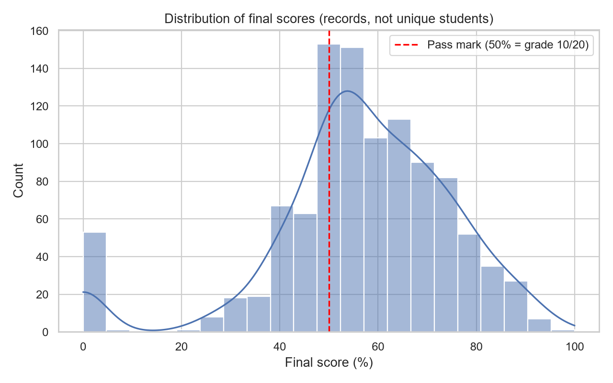
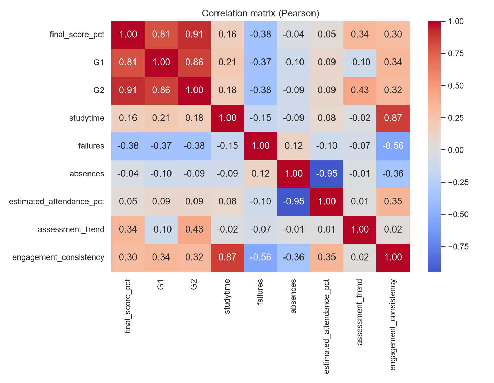
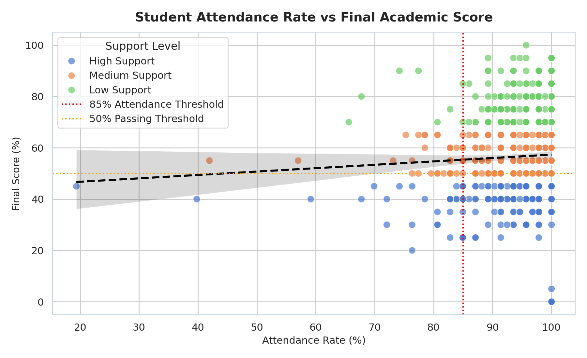
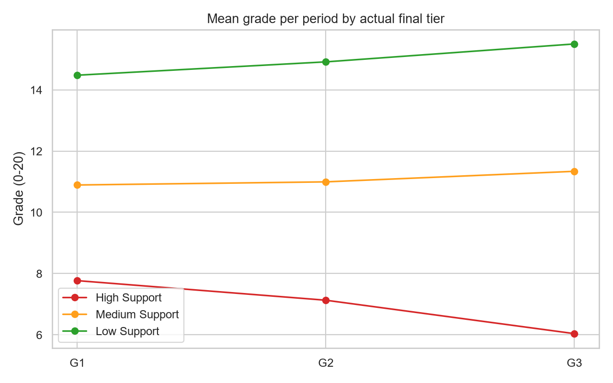
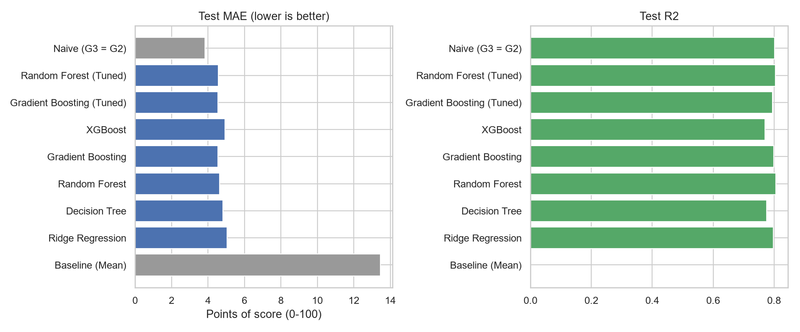
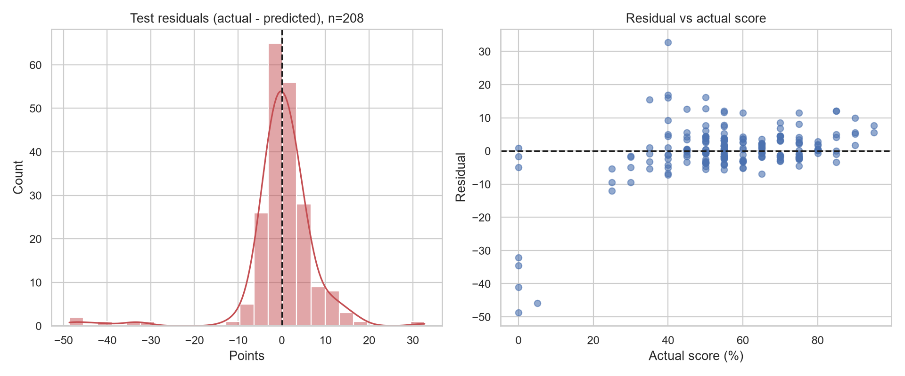

# 🎓 TREKVERSE — Intelligent Academic Performance Monitoring & Recommendation System

[](https://www.python.org/)
[](https://streamlit.io/)
[](https://scikit-learn.org/)
[](https://shap.readthedocs.io/)
[](https://www.sqlite.org/)
[](https://www.reportlab.com/)
[](https://pytest.org/)

> **Live Demo & Deployment**: Deployable instantly on [Streamlit Community Cloud](https://share.streamlit.io/) or run locally with `streamlit run app/app.py`.  
> **Capstone Project Lead**: Salapala Tharun Kumar Reddy · **Roll No.**: 232G1A3249 · **Institution**: Trekverse AI Academy

---

## 📌 Executive Summary

**TREKVERSE** transforms student performance forecasting into a multi-role, explainable academic intelligence and decision-support platform. Rather than predicting only a static final examination grade, the system unifies:

- 📊 **Academic Progress Monitoring**: Tracking subject-level internal evaluations, attendance trends, and engagement consistency.
- 🔮 **Predictive Performance Forecasting**: Grouped student-aware regression predicting final grades on a 0–100 scale and 0–20 academic scale.
- 🚨 **Calibrated Early-Warning System**: Transparent risk classification (🟢 Low Risk, 🟡 Moderate Risk, 🔴 High Risk) with actionable follow-up protocols.
- 🧠 **Explainable AI (SHAP)**: Prediction-level feature attributions highlighting top positive momentum drivers and risk factors.
- 🎛️ **What-If Scenario Simulator**: Interactive habit modeling allowing students and faculty to simulate behavioral improvements (e.g. increasing study time or cutting absences) with live delta estimations.
- 📅 **AI-Personalized Study Planner**: Dynamic weekly schedules tailored to student-specific weak subjects, available daily study hours, and upcoming exam targets with interactive checklists.
- 🏛️ **Role-Based Portals**: Dedicated, secure workflows for **Administrators**, **Faculty Mentors**, and **Students**.
- 📥 **Institutional Data Ingestion & Validator**: Multi-format import for **CSV** and **Excel (.xlsx)** with column mapping wizards and row-level range checks.
- 📄 **Certified PDF Report Generation**: One-click compilation of institutional academic progress summaries using ReportLab.
- 🗄️ **Relational Database Persistence**: Backed by a normalized SQLite schema logging users, cohorts, attendance, marks, predictions, and faculty interventions.

---

## 🌟 Visual Showcase & Dashboards

| 📈 Grade Distribution & Support Tiers | 🗺️ Curricular Correlation Matrix |
| :---: | :---: |
|  |  |

| 🎯 Attendance vs Final Achievement | 📉 Longitudinal Evaluation Trajectory |
| :---: | :---: |
|  |  |

| 🏆 Model Benchmark Comparison | 🔬 Regressor Residual Error Diagnostics |
| :---: | :---: |
|  |  |

---

## 🚀 Core Platform Capabilities

### 1. 🚨 Early-Warning & Risk Classification System
Multi-dimensional academic records (attendance rate, internal exams G1/G2, previous backlogs, study hours) are evaluated against validated risk bands:

| Risk Band | Meaning | Prescribed Action Protocol |
|---|---|---|
| 🟢 **Low Risk** | Performing satisfactorily; on track for academic milestones. | Continue normal monitoring and positive feedback. |
| 🟡 **Moderate Risk** | One or more indicators suggest targeted support is beneficial. | Faculty check-in, review weak course modules, agree on action plan. |
| 🔴 **High Risk** | Multiple high-priority indicators require prompt human review. | Immediate faculty mentoring, attendance recovery plan, and tutoring. |

---

### 2. 🎛️ What-If Academic Scenario Simulator
Enables students and faculty mentors to explore "what-if" adjustments to academic habits and observe the model's response:
- **Simulated Variables**: Weekly study hours, recorded absences, and target mid-term marks.
- **Side-by-Side Comparison**: Displays baseline metrics against the simulated scenario with calculated score deltas (e.g. `+12.4%` / `+2.5 grade points`).
- **Safety Safeguard**: Outputs are explicitly labeled as statistical estimates, never guarantees. Original database records remain untouched.

---

### 3. 👥 Role-Based Experiences & Portals

```
TREKVERSE Application
├── 👑 Administrator Control Center (app/pages/admin.py)
│   ├── Academic Metadata & Role Management (Users, Faculty, Students)
│   ├── Institutional Dataset Import & Validator (CSV & Excel .xlsx)
│   ├── Automated Column Mapping Wizard & Row-Level Error Reports
│   ├── Machine Learning Model Registry & Health Monitoring
│   ├── System Audit Logs & Operational Security Trails
│   └── Configurable Risk Thresholds & Institutional Governance
│
├── 👨‍🏫 Faculty Intervention Dashboard (app/pages/faculty.py)
│   ├── Cohort Surveillance (Class average, attendance average, risk distribution)
│   ├── Priority Early-Warning Roster (High & Moderate risk queues)
│   ├── Student Diagnostic Deep-Dive (Subject marks, attendance, failure counts)
│   ├── Faculty Intervention Workflow (Record mentoring notes, remedial actions)
│   └── Longitudinal Intervention History & Outcome Tracking
│
└── 🎓 Student Academic Portal (app/pages/student.py)
    ├── Profile & Degree Progress (Roll number, current semester, standing)
    ├── Enrolled Courses, Marks Breakdown, and Attendance Monitor
    ├── AI Early-Warning Diagnostics & Factor Explanations
    ├── Interactive AI-Personalized Weekly Study Planner (Task checklists)
    └── Downloadable Certified Academic PDF Report
```

---

### 4. 📄 Certified Institutional PDF Report Generator
Built with **ReportLab**, the system automatically compiles downloadable reports including:
1. **Official Institutional Header**: TREKVERSE Academy credentials, timestamp, and status.
2. **Student Profile**: Roll number, department, semester, cumulative CGPA, and attendance rate.
3. **Curricular Performance Table**: Credits, attendance %, internal marks, and evaluation status.
4. **AI Performance Forecast & Risk Level**: Final score estimate, 95% uncertainty interval, and risk classification.
5. **Explainability Attributions**: Top features raising or lowering the forecast.
6. **Study Action Plan**: Weekly subject breakdown roadmap.
7. **Authorized Faculty Remarks**: Formal comments and agreed follow-up milestones.
8. **Institutional Governance Disclaimer**: Formal statement reinforcing decision-support ethics.

---

## 🔬 Machine Learning Pipeline & Empirical Benchmarks

The predictive pipeline is evaluated using **Grouped 5-Fold Cross-Validation** (grouped by student fingerprint to prevent data leakage) on training data, evaluated once on a held-out test split of **208 records**:

- **Selected Regressor**: **Gradient Boosting (Tuned)**
  - **Test MAE**: **4.54** points (0–100 scale)
  - **Test R²**: **0.795**
  - **Cross-Validation MAE**: **4.27** points
- **Selected Classifier**: **Random Forest (Tuned)**
  - **Test Accuracy**: **87.0%**
  - **Test Macro-F1**: **0.871**
  - **Cross-Validation Macro-F1**: **0.855**
- **Exploratory Clustering**: K-Means ($k=4$) segmentation of student study behaviors and engagement patterns.
- **Explainability**: SHAP (TreeExplainer) additive attributions verifying feature contributions.

---

## 🗄️ Database Architecture & Entity Relationships

The relational database is implemented in **SQLite** with strict foreign keys and index optimization:

- `users`: Identity authentication, password hashes, and system roles (`admin`, `faculty`, `student`).
- `departments`: Academic division codes, names, and department heads.
- `faculty`: Faculty IDs, employee codes, designations, and department associations.
- `students`: Roll numbers, names, semesters, CGPA, average attendance, and risk standing.
- `subjects`: Course codes, subject titles, credit allocations, and semester mappings.
- `attendance`: Class session tracking, attended sessions, and attendance percentages.
- `marks`: Exam types (`Internal-1`, `Internal-2`, `Quiz`, `Final`), scores, and percentages.
- `predictions`: Persisted ML forecast scores, risk classifications, uncertainty bounds, and version tags.
- `interventions`: Faculty mentoring records, action notes, follow-up dates, and review statuses.
- `audit_logs`: Governance trail tracking security events, dataset uploads, and policy adjustments.

---

## 📂 Project Structure

```
Intelligent-Academic-Monitoring/
├── app/
│   ├── app.py                     # Main Portal with Session State & Role Routing
│   ├── main.py                    # Consolidated Multi-Tab Application
│   └── pages/
│       ├── admin.py               # 🏛️ Administrator Dashboard & Settings
│       ├── faculty.py             # 👨‍🏫 Faculty Dashboard & Intervention Queue
│       ├── student.py             # 🎓 Student Dashboard, Planner & PDF Report
│       ├── analytics.py           # 📊 Academic Visual Analytics
│       ├── prediction.py          # 🔮 ML Performance Forecast & What-If Simulator
│       └── reports.py             # 📄 Downloadable PDF Report Generator
├── assets/                        # High-resolution visual figures and charts
├── data/
│   ├── raw/                       # Raw UCI benchmark datasets (student-mat, student-por)
│   ├── processed/                 # Cleaned datasets, train.csv, and test.csv
│   └── uploads/                   # Upload destination for validated college files
├── database/
│   ├── schema.sql                 # Complete relational SQLite DDL schema
│   └── database.py                # Database connection, ORM layer, and seed routines
├── docs/
│   ├── images/                    # Generated charts for documentation
│   ├── DATA_DICTIONARY.md         # Schema descriptions and feature definitions
│   └── FINAL_TECHNICAL_REPORT.md  # Comprehensive technical methodology report
├── models/
│   ├── model_registry/            # Serialized versioned joblib models & JSON metadata
│   ├── preprocessor/              # Preprocessing column transformers
│   ├── best_regressor.joblib      # Gradient Boosting model
│   ├── best_classifier.joblib     # Random Forest model
│   └── evaluation_summary.json    # Verified evaluation benchmark metrics
├── reports/
│   └── report_generator.py        # ReportLab PDF compilation engine
├── src/
│   ├── preprocessing/             # Data cleaning and student-aware splitting
│   ├── feature_engineering/       # Grade trends and engagement indices
│   ├── training/                  # Cross-validation and model training
│   ├── prediction/                # StudentPredictor class & inference service
│   ├── explainability/            # SHAP explainer and permutation importance
│   ├── recommendations/           # Actionable recommendations and study planner
│   ├── clustering/                # K-Means exploratory segmentation
│   ├── run_pipeline.py            # End-to-end pipeline execution runner
│   └── validation.py              # Input schema bounds checking
├── tests/                         # Comprehensive pytest test suite (Verified & passing)
├── requirements.txt               # Pinned project dependencies
└── README.md                      # Platform documentation
```

---

## ⚡ Quickstart & Installation

### 1. Clone the Repository
```bash
git clone https://github.com/Tharun-720/Student-Performance---AI.git
cd Student-Performance---AI
```

### 2. Set Up Virtual Environment
```bash
python -m venv venv
# On Windows:
venv\Scripts\activate
# On Linux / macOS:
source venv/bin/activate
```

### 3. Install Dependencies
```bash
pip install -r requirements.txt
```

### 4. Run the Full Machine Learning Pipeline (Optional Re-training)
```bash
python -m src.run_pipeline
```

### 5. Launch the Streamlit Web Application
```bash
streamlit run app/app.py
```
*Access the platform in your browser at `http://localhost:8501`.*

---

## 🧪 Test Suite

Run the full automated test suite covering preprocessing, training, inference, What-If simulation, database operations, and PDF generation:

```bash
pytest -v
```

---

## 🛡️ Responsible AI & Ethical Safeguards

1. **Human-in-the-Loop Decision Support**: Predictions must aid faculty review, counseling, and early intervention—never replace qualified human judgment.
2. **Non-Consequential Independence**: The system must never be used as the sole determinant for punitive actions, denial of advancement, or disqualification.
3. **Transparent Explainability**: Every score forecast provides local SHAP attribution so stakeholders understand why a prediction was made.
4. **Data Integrity & Governance**: Uploaded files undergo mandatory schema checking, preventing corrupt or anomalous records from skewing institutional insights.

---

## 📄 License & Attribution

- **Dataset**: UCI Machine Learning Repository — *Student Performance Dataset* (CC BY 4.0).
- **License**: MIT Open Source License.  
- **Author**: Salapala Tharun Kumar Reddy · Trekverse AI Academy
